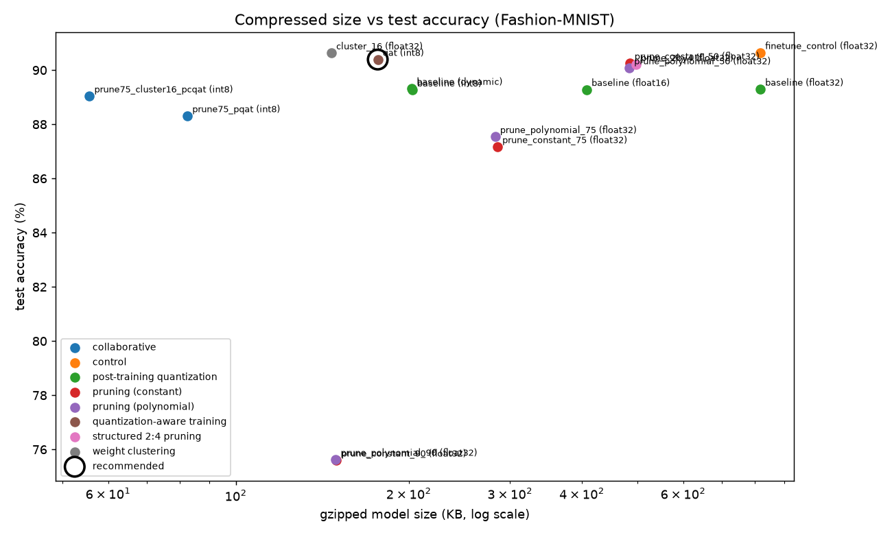
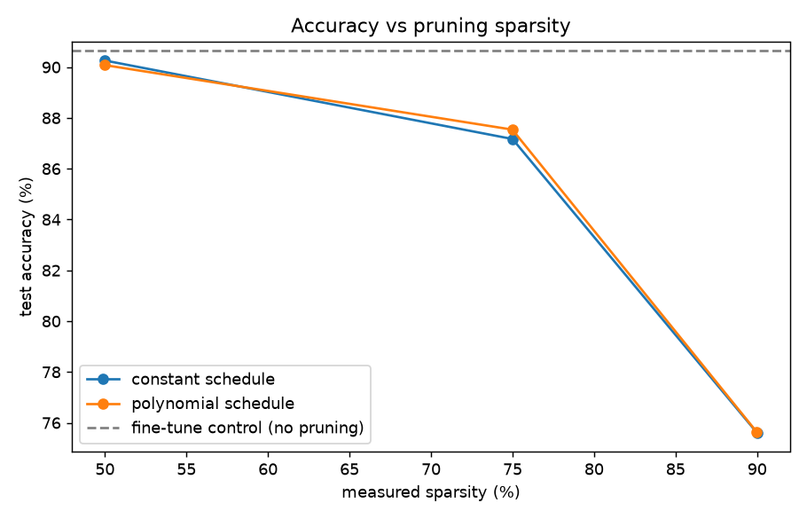

# MLOps Lab 4 – Model Optimization: Pruning, Clustering & Quantization (TensorFlow)

Lab submission for DADS7305 MLOps (Northeastern University), Model Development topic.
Based on the course lab [Model_Development/Quantization_and_Pruning](https://github.com/raminmohammadi/MLOps/tree/main/Labs/Model_Development/Quantization_and_Pruning).

The original notebook trains a small CNN on MNIST for one epoch and tries three techniques –
dynamic-range post-training quantization, quantization-aware training, and one pruning schedule –
comparing sizes in mixed formats (`.h5` vs `.tflite`, sometimes gzipped, sometimes not) and with
each model trained a different amount.

This version turns it into a **reproducible model-compression benchmark** on **Fashion-MNIST**:
**16 model variants** from **8 techniques**, every one measured the same way (TF Lite accuracy,
per-class accuracy, raw + gzipped size, single-thread latency, sparsity, distinct weight values),
compared fairly against a **fine-tune control**, and a deployment **budget** that picks the
recommended model automatically – including a per-class check that catches models that look fine
overall but break one class.

## Source

`original/Quantization_and_Pruning.ipynb` is the unmodified course notebook.

## My changes

### Model optimization changes (the core of the lab)

| | Original lab | This submission |
|---|---|---|
| **Post-training quantization** | Dynamic range only (`Optimize.DEFAULT`) | All four TF Lite precisions: **float32**, **float16**, **dynamic range**, and **full-integer int8** with a representative calibration dataset and int8 inputs/outputs (what edge TPUs and microcontrollers require) |
| **Quantization-aware training** | Trained from scratch for 1 epoch | Fine-tuned from the **trained** baseline, then converted to full int8 |
| **Pruning** | One run: `PolynomialDecay` 50→80% | **Sweep** of 50 / 75 / 90% sparsity × **two schedules** (polynomial ramp vs constant), with the mask-update frequency scaled to the run length |
| **Structured pruning** | – | **2:4 sparsity** (`sparsity_m_by_n=(2, 4)`): in every block of 4 weights, 2 are zero – the pattern sparse GPU kernels can accelerate. A test checks the block pattern |
| **Weight clustering** | – | **16 shared values per layer** (`tfmot.clustering`, k-means++ init) |
| **Collaborative optimization** | – | Chains that keep earlier compression through later steps: **prune → PQAT** (pruning-preserving QAT) and **prune → sparsity-preserving clustering → PCQAT** (keeps both zeros and clusters), converted to int8 |
| **Fair comparison** | Baseline 1 epoch, QAT 1 epoch from scratch, pruning 2 more epochs on top – different training per model | Every technique starts from a **copy of the same trained baseline** and gets **the same fine-tuning budget** (2 epochs, lr 1e-4). A **fine-tune control** gets that budget with no compression; accuracy drops of fine-tuned techniques are measured against it, so no technique looks better just because it trained longer |
| **Measurement** | Accuracy + file size (formats mixed) | Same harness for every model: TF Lite test accuracy, **per-class accuracy**, raw and **gzipped** size, **median single-thread latency** (200 runs), measured sparsity, max distinct weight values per layer |
| **Interpreter** | `tf.lite.Interpreter` (deprecated) | **LiteRT** (`ai_edge_litert`), the supported replacement |
| **Model selection** | Reader compares printed numbers | `config.yaml` **deployment budget**: smallest gzipped model with ≤ 1 pp overall accuracy loss **and** ≤ 3 pp loss on any single class; ties go to the faster model |
| **Outputs** | Printed dictionaries | `results/results.csv`, `results.md`, `summary.json`, two plots, all 16 `.tflite` models |
| **Code structure** | One notebook | `optimize/` package (data, model, techniques, conversion, evaluation, report) + `run_experiments.py` CLI with a `--quick` mode |
| **Testing / CI** | None | 16 pytest tests (target sparsity reached, 2:4 block pattern, cluster count, chains keep sparsity, every precision agrees with Keras, int8 I/O types, report logic) including an end-to-end `--quick` run; GitHub Actions runs them |

### Data and model changes

| | Original lab | This submission |
|---|---|---|
| **Dataset** | MNIST digits | **Fashion-MNIST** – 70,000 28×28 images of clothing in 10 classes (T-shirt, Trouser, Pullover, Dress, Coat, Sandal, Shirt, Sneaker, Bag, Ankle boot). Harder than MNIST, so compression losses are visible |
| **Model** | 1 conv layer (12 filters) + softmax, ~20k weights | 2 conv blocks (32, 64 filters) + Dense(128) + softmax, **~225k parameters** (883 KB as float32 TF Lite) – big enough for compression to matter |
| **Training** | 1 epoch, no validation | 5 epochs with a 10% validation split, fixed seed |

## Project layout

| Path | What it is |
|---|---|
| `run_experiments.py` | Runs everything: train → 8 techniques → convert → measure → report |
| `config.yaml` | Epochs, fine-tuning budget, pruning targets/schedules, cluster count, deployment budget, `--quick` settings |
| `optimize/data.py` | Fashion-MNIST loading, calibration (representative) dataset |
| `optimize/models.py` | Baseline CNN, shared training loop |
| `optimize/techniques.py` | Pruning, 2:4 pruning, clustering, QAT, PQAT, PCQAT, weight statistics |
| `optimize/convert.py` | Keras → TF Lite in float32 / float16 / dynamic / int8 |
| `optimize/evaluate.py` | LiteRT accuracy, per-class accuracy, sizes, latency |
| `optimize/report.py` | Comparison table, recommendation, plots |
| `results/` | Results from the run below (models are regenerated, not committed) |
| `tests/` | pytest suite |
| `original/` | Unmodified course notebook |

## 1. What you need to install

| Tool | Version | Notes |
|---|---|---|
| **Python** | **3.13** (tested on 3.13.15; 3.10–3.13 work) | [python.org/downloads](https://www.python.org/downloads/). On Windows tick "Add python.exe to PATH" |
| Git | any | To clone the repo |

No GPU, Docker or conda needed – everything runs on the CPU (tested on an Apple Silicon Mac; TensorFlow
2.21 also ships wheels for Intel/AMD Linux and Windows). Python packages are pinned in `requirements.txt`:
TensorFlow 2.21.0, tf-keras 2.21.0, tensorflow-model-optimization 0.8.1, ai-edge-litert 2.3.0, numpy 2.5.4,
pandas 3.1.0, matplotlib 3.11.2, PyYAML 6.0.3, pytest 9.1.1. Internet is needed once (packages ≈ 1.7 GB installed, mostly TensorFlow;
Fashion-MNIST ≈ 30 MB, cached in `~/.keras/datasets`).

> **Why tf-keras?** TensorFlow 2.16+ uses Keras 3 by default, but the Model Optimization Toolkit only supports
> Keras 2. The `optimize` package sets `TF_USE_LEGACY_KERAS=1` before TensorFlow loads, so it uses `tf_keras`
> automatically – nothing to configure.

## 2. Set up the environment

```bash
git clone https://github.com/Vishwapujara/mlops-lab4-tf-model-optimization-fashion-mnist.git
cd mlops-lab4-tf-model-optimization-fashion-mnist

python3 -m venv .venv
source .venv/bin/activate          # Windows: .venv\Scripts\activate
pip install --upgrade pip
pip install -r requirements.txt
```

Optional check (~25 s, includes a small end-to-end run):

```bash
pytest
# 16 passed
```

## 3. Run the experiments

```bash
python run_experiments.py           # full run: ~2.5 minutes on a laptop CPU
python run_experiments.py --quick   # 3,000 images, 1 epoch: ~15 seconds, for a fast check
```

The first run downloads Fashion-MNIST. The script prints Keras training logs, then one line per model:

```
[1/7] Baseline + post-training quantization
  -> baseline (float32)                 acc 0.8929 |   883.5 KB (gzip  817.0) | 0.025 ms | sparsity 0%
  -> baseline (float16)                 acc 0.8928 |   445.3 KB (gzip  407.6) | 0.027 ms | sparsity 0%
  -> baseline (dynamic)                 acc 0.8932 |   228.3 KB (gzip  202.4) | 0.034 ms | sparsity 0%
  -> baseline (int8)                    acc 0.8926 |   231.0 KB (gzip  202.7) | 0.021 ms | sparsity 0%
[2/7] Fine-tune control (same extra training, no compression)
  -> finetune_control (float32)         acc 0.9064 |   883.5 KB (gzip  817.0) | 0.028 ms | sparsity 0%
[3/7] Quantization-aware training
  -> qat (int8)                         acc 0.9039 |   228.3 KB (gzip  176.6) | 0.021 ms | sparsity 0%
...
[7/7] Collaborative optimization (prune -> [cluster] -> QAT, int8)
  -> prune75_pqat (int8)                acc 0.8831 |   228.3 KB (gzip   82.4) | 0.021 ms | sparsity 75%
  -> prune75_cluster16_pcqat (int8)     acc 0.8904 |   228.3 KB (gzip   55.7) | 0.021 ms | sparsity 75%
```

and ends with the full table and:

```
RECOMMENDED: qat (int8) - 4.6x smaller (gzip), 1.20x faster, accuracy +0.25 pp, worst class Shirt +1.50 pp
Results written to results/ in 144 s
```

A successful run creates:

```
results/
├── results.csv / results.md     # the table below
├── summary.json                 # baseline, budget, recommended model
├── plots/size_vs_accuracy.png
├── plots/pruning_sparsity.png
└── models/*.tflite              # all 16 models, ready to deploy
```

Accuracy and file sizes are reproducible (fixed seed – two runs gave identical numbers). Latency is
around 0.02–0.03 ms per image, so it moves by a few microseconds between runs; the int8 models are
consistently the fastest.

## 4. Results

From the run on an Apple Silicon Mac (`results/results.md`). `accuracy_drop_pp` is in percentage
points versus each model's own uncompressed starting point (the baseline for post-training quantization,
the fine-tune control for everything else); **positive = worse**.

| variant | technique | accuracy | drop (pp) | worst class drop (pp) | worst class | size KB | gzip KB | gzip smaller | latency ms | sparsity | distinct values |
|---|---|---|---|---|---|---|---|---|---|---|---|
| baseline (float32) | post-training quantization | 0.8929 | +0.00 | +0.00 | – | 883.5 | 817.0 | 1.0x | 0.025 | 0% | 204,516 |
| baseline (float16) | post-training quantization | 0.8928 | +0.01 | +0.10 | T-shirt/top | 445.3 | 407.6 | 2.0x | 0.027 | 0% | 204,516 |
| baseline (dynamic) | post-training quantization | 0.8932 | -0.03 | +0.10 | T-shirt/top | 228.3 | 202.4 | 4.0x | 0.034 | 0% | 204,516 |
| baseline (int8) | post-training quantization | 0.8926 | +0.03 | +1.10 | Shirt | 231.0 | 202.7 | 4.0x | 0.021 | 0% | 204,516 |
| finetune_control (float32) | control | 0.9064 | +0.00 | +0.00 | – | 883.5 | 817.0 | 1.0x | 0.028 | 0% | 204,506 |
| **qat (int8)** ⭐ | quantization-aware training | 0.9039 | +0.25 | +1.50 | Shirt | 228.3 | 176.6 | **4.6x** | 0.021 | 0% | 204,493 |
| prune_polynomial_50 | pruning (polynomial) | 0.9008 | +0.56 | +1.70 | Pullover | 883.5 | 483.5 | 1.7x | 0.030 | 50% | 102,228 |
| prune_polynomial_75 | pruning (polynomial) | 0.8754 | +3.10 | +6.80 | Shirt | 883.5 | 282.6 | 2.9x | 0.030 | 75% | 51,167 |
| prune_polynomial_90 | pruning (polynomial) | 0.7563 | +15.01 | +53.90 | Shirt | 883.5 | 149.3 | 5.5x | 0.026 | 90% | 20,495 |
| prune_constant_50 | pruning (constant) | 0.9026 | +0.38 | +1.70 | Pullover | 883.5 | 484.1 | 1.7x | 0.030 | 50% | 102,235 |
| prune_constant_75 | pruning (constant) | 0.8717 | +3.47 | +10.00 | Shirt | 883.5 | 285.1 | 2.9x | 0.030 | 75% | 51,163 |
| prune_constant_90 | pruning (constant) | 0.7560 | +15.04 | +48.20 | Shirt | 883.5 | 149.6 | 5.5x | 0.030 | 90% | 20,473 |
| prune_2by4 | structured 2:4 pruning | 0.9020 | +0.44 | +1.20 | Pullover | 883.5 | 496.4 | 1.6x | 0.030 | 50% | 102,288 |
| cluster_16 | weight clustering | 0.9063 | +0.01 | **+4.10** | Pullover | 883.5 | 146.6 | 5.6x | 0.030 | 0% | **16** |
| prune75_pqat (int8) | collaborative | 0.8831 | +2.33 | +6.50 | Shirt | 228.3 | 82.4 | 9.9x | 0.021 | 75% | 51,163 |
| prune75_cluster16_pcqat (int8) | collaborative | 0.8904 | +1.60 | +4.20 | Coat | 228.3 | **55.7** | **14.7x** | 0.021 | 75% | **16** |





**What the results show**

- **Recommended: QAT int8** – 4.6× smaller (gzip), fastest on CPU, only 0.25 pp below the fine-tune control, and no class loses more than 1.5 pp.
- **The per-class check matters.** Weight clustering is 5.6× smaller with *no* overall accuracy loss (+0.01 pp), but `Pullover` drops 4.1 pp – the budget rejects it. Looking at overall accuracy alone would have shipped it.
- **Quantization is nearly free**: all four post-training precisions stay within 0.03 pp of float32. Full int8 matches dynamic range in size but is faster, because the arithmetic is integer too.
- **Pruning alone doesn't shrink the file** (883.5 KB for every pruned model) – zeros only pay off after compression (gzip 1.7× at 50%, 5.5× at 90%) or with sparse kernels. Past 50% accuracy falls quickly, and the `Shirt` class (the one most confused with T-shirts and pullovers) collapses first: −54 pp at 90%.
- **Polynomial vs constant schedule**: about the same here; the gradual ramp is slightly better at 75%.
- **Combining techniques compounds**: prune 75% → cluster 16 → PCQAT keeps both the 75% zeros and the 16 values through quantization-aware training (see the sparsity and distinct-values columns), giving the smallest model (55.7 KB, 14.7×) at 1.6 pp – the best choice if the budget were looser (e.g. 2 pp overall, 5 pp per class).

Change the budget, targets or epochs in `config.yaml` and re-run to explore other trade-offs.

## Running the tests

```bash
pytest -v          # 16 passed, ~25 s
```

The unit tests use a small synthetic dataset and check each technique does what it claims (target sparsity,
2:4 block pattern, ≤ N distinct values after clustering, PQAT/PCQAT keep the zeros), that every TF Lite
precision gives the same predictions as Keras, the int8 model's input/output types, and the report's
matched-reference and budget logic. `test_quick_run_end_to_end` runs the whole pipeline in `--quick` mode
on real Fashion-MNIST. GitHub Actions runs the same suite on every push.

## Starting over

```bash
rm -rf results          # then run python run_experiments.py again
```
